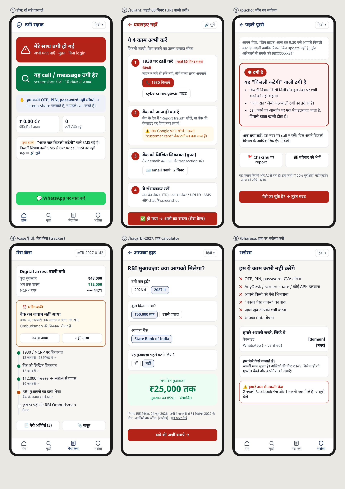

# ठगी रक्षक: भाग 2, ढाँचा, Design और Planning

> तारीख़: 21 नवंबर 2026 · स्थिति: **मसौदा, मालिक की मंज़ूरी बाकी है**
>
> यह दस्तावेज़ "Design Doc v2" (`2026-11-21-thagi-rakshak-design.md`) के साथ पढ़ा जाए। v2 बताता है **क्या और क्यों**। यह दस्तावेज़ बताता है **कैसा दिखेगा, कैसे बनेगा, और कब**।
>
> निशान वही हैं: **[मेरा फ़ैसला]** · **[पुष्टि ज़रूरी]** · **[अनुमान]**

## विषय-सूची
1. Design के 8 सिद्धांत
2. मुख्य screens के mockups
3. Design system (रंग, अक्षर, आकार, components)
4. बोलने का लहजा (Voice & tone) और शब्दकोश
5. Navigation का ढाँचा
6. हर पन्ने का पूरा ब्योरा (Page specs)
7. ठगी के प्रकारों की सूची (Taxonomy)
8. User की पूरी यात्राएँ (Journeys)
9. WhatsApp पर बातचीत का ढाँचा
10. ज्ञानकोश के पन्ने का ढाँचा
11. Code का ढाँचा (folders, modules, API, cron)
12. Admin और रोज़ के काम का तरीका (Ops SOPs)
13. Planning: हफ़्ते-दर-हफ़्ते (23 नवंबर 2026 से 28 मार्च 2027)
14. टीम, समय और बजट
15. "पूरा हुआ" की परिभाषा (Definition of Done)

---

## 1. Design के 8 सिद्धांत

1. **घबराहट में 3 सेकंड:** कोई भी पन्ना खुले, तो 3 सेकंड में दिख जाए कि "अगला काम क्या है"। हर screen पर **एक मुख्य बटन** हो, बाकी सब उसके बाद।
2. **ज़रूरी चीज़ बिना login के:** /turant, /pucho, /haq और /gyan बिना account के खुलें। account तभी माँगा जाए, जब user ख़ुद "आगे साथ चलो" कहे।
3. **हर दावे के साथ स्रोत:** हर हक़, नियम और नंबर के साथ "कहाँ लिखा है" का link और "आख़िरी बार जाँचा" की तारीख़।
4. **कभी झूठी तसल्ली नहीं:** "100% सुरक्षित", "पक्का पैसा वापस", "गारंटी" जैसे शब्द design system में ही मना हैं। copy की जाँच वाली सूची (lint) में ये शब्द पकड़े जाएँगे।
5. **सरकारी नकल नहीं:** तिरंगे के रंगों की पट्टी, अशोक चिह्न, "भारत सरकार" जैसा रूप, या ".gov" जैसा दिखने वाला कुछ भी नहीं। हम सरकार नहीं हैं, और वैसा दिखने का मतलब होगा ठगों जैसा बर्ताव। सरकारी नाम और चिह्नों के इस्तेमाल पर कानून भी है **[पुष्टि ज़रूरी: वकील से]**।
6. **रंग अकेले कुछ नहीं कहेगा:** लाल, पीला और हरा हमेशा icon और शब्द के साथ, ताकि रंग न पहचान पाने वाले भी समझ सकें।
7. **कमज़ोर फ़ोन पहले:** design और test ₹7,000 वाले Android फ़ोन और धीमे 3G पर पहले होंगे, iPhone पर बाद में।
8. **हर शब्द का भार:** हर वाक्य छोटा, क्रिया पहले ("1930 पर call करें"), कोई कानूनी भारी शब्द बिना समझाए नहीं।

---

## 2. मुख्य screens के mockups



| # | Screen | ध्यान देने वाली बातें |
|---|---|---|
| ① | होम | सिर्फ़ दो बड़े दरवाज़े · प्रतिज्ञा पहली नज़र में · "इस हफ़्ते की ठगी" से रोज़ लौटने की वजह · WhatsApp का बटन |
| ② | /turant | 4 कदम, हर कदम पर एक बटन · "Google पर नंबर न खोजें" की चेतावनी · 🔊 सुनें · आख़िर में "आगे का रास्ता" |
| ③ | /pucho नतीजा | user ने जो भेजा वह ऊपर · 🔴 के साथ तीन कारण · "अब क्या करें" · Chakshu और परिवार वाले बटन · "100% सुरक्षित नहीं कहते" |
| ④ | /case tracker | पैसे का हिसाब ऊपर · **अभी का काम** पीले box में, deadline के साथ · एक-tap जवाब · timeline |
| ⑤ | /haq calculator | एक बार में एक सवाल · नतीजा "संभावित" लेबल के साथ · नियम का स्रोत और तारीख़ |
| ⑥ | /bharosa | "कभी नहीं करेंगे" की सूची · असली नंबर · कमाई कैसे होती है · नकली पेजों की चेतावनी |

> mockups का HTML: `assets/thagi-rakshak-mockups.html`। design system बनते समय इसी को शुरुआत माना जाए।

---

## 3. Design system

### 3.1 रंग (tokens)
| Token | Light | मतलब / इस्तेमाल |
|---|---|---|
| `--brand` | `#1D3A6B` (गहरा नीला) | पहचान, links, चुना हुआ विकल्प। भरोसे का रंग, पर सरकारी नहीं |
| `--brand-bg` | `#EEF2F8` | प्रतिज्ञा जैसे शांत box |
| `--danger` | `#B42318` | सिर्फ़ इमरजेंसी और "ठगी है"। **रोज़मर्रा के बटन लाल नहीं होंगे** |
| `--danger-bg` | `#FEF3F2` | |
| `--warn` | `#B54708` | "शक है", deadline पास है |
| `--warn-bg` | `#FFFAEB` | |
| `--safe` | `#067647` | "निशान नहीं मिले", पैसा वापस आया |
| `--safe-bg` | `#ECFDF3` | |
| `--ink` | `#101828` | मुख्य text |
| `--muted` | `#475467` | दूसरे दर्जे का text |
| `--line` | `#E4E7EC` | किनारे |
| `--paper` | `#FFFFFF` | card |
| `--surface` | `#F7F6F3` | पन्ने का background (गरम काग़ज़ जैसा, marketplace से मेल खाता) |

- सभी text और background के जोड़े में **WCAG AA contrast** (कम से कम 4.5:1) होना चाहिए। build में इसकी जाँच का script होगा।
- dark mode के लिए हर token का अलग मान होगा। इमरजेंसी पन्ने पर dark mode में भी लाल साफ़ दिखना चाहिए।

### 3.2 अक्षर (Typography)
| चीज़ | फ़ैसला |
|---|---|
| font | **Noto Sans Devanagari** (हिंदी + अंग्रेज़ी दोनों) **[मेरा फ़ैसला]** |
| /turant पर | **web font नहीं, सिर्फ़ system font।** Android में हिंदी font पहले से होता है, तो 2G पर एक भी फ़ाइल ज़्यादा नहीं आएगी |
| शरीर का text | 18px, line-height 1.6 (मात्राओं के लिए ऊँची लाइन ज़रूरी) |
| छोटा text | 14px से छोटा कुछ नहीं, सिवाय स्रोत और तारीख़ के (12px) |
| शीर्षक | 22 / 19 / 16px, weight 700 |
| अंक | ₹ हमेशा भारतीय ढंग से: ₹48,000 · ₹1,25,000 (`Intl.NumberFormat('en-IN')`) |
| तारीख़ | "12 जनवरी 2027", कभी "01/12/27" नहीं (भारत और अमेरिका में इसका मतलब उल्टा होता है) |

### 3.3 आकार और दूरी
- दूरी 4px के पैमाने पर: 4 · 8 · 12 · 16 · 24 · 32।
- छूने वाली हर चीज़ कम से कम **48px** ऊँची। मुख्य बटन 56px, और बड़े दरवाज़े वाले बटन 88px।
- कोने की गोलाई: card 12-14px, बटन 9-12px।
- पन्ने की चौड़ाई: मोबाइल पर किनारे से 16px, desktop पर text 680px से ज़्यादा चौड़ा नहीं।

### 3.4 Components (हर एक का नाम, काम और हालतें)
| Component | काम | हालतें (states) |
|---|---|---|
| `BigDoor` | होम के दो बड़े दरवाज़े | normal, pressed |
| `StepCard` | क्रम वाला कदम: नंबर, शीर्षक, समझाना, बटन, timer | todo, doing, done, skipped |
| `UrgencyTimer` | "पहले 30 मिनट सबसे कीमती" | सिर्फ़ जानकारी, गिनती वाली घड़ी नहीं **[मेरा फ़ैसला]** (घबराहट न बढ़े) |
| `VerdictCard` | पहले पूछो का नतीजा | danger, warn, no-signals |
| `RightsResult` | हक़ का नतीजा | confirmed, likely, unclear, not-eligible |
| `DeadlineChip` | "4 दिन बाकी" | far, near (≤3 दिन), today, missed |
| `Timeline` | केस की हालतें | done, now, next |
| `OneTapAnswer` | "जवाब आया? हाँ/नहीं" | idle, sending, saved |
| `DocumentCard` | अर्ज़ी: PDF / copy / email / print | generating, ready, outdated (नया template आ गया) |
| `CopyBlock` | copy करने लायक text, साथ में "Copy हो गया ✓" | |
| `ListenButton` | 🔊 सुनें (TTS) | idle, playing, unsupported |
| `TrustBar` | पन्ने के नीचे प्रतिज्ञा की एक लाइन | |
| `SourceLine` | "नियम: ... · आख़िरी बार जाँचा: ... · मूल text" | |
| `PledgeList` | /bharosa की "कभी नहीं" सूची | |
| `OfflineBanner` | "आप offline हैं, यह पन्ना फिर भी काम करेगा" | |
| `EmptyState` / `ErrorState` | हर सूची और हर गड़बड़ के लिए | error वाला संदेश कभी तकनीकी नहीं होगा। हमेशा "अब क्या करें" साथ में |
| `ConsentSheet` | सहमति: क्या, क्यों, कब तक | granted, withdrawn |
| `PaySheet` | ₹149 + "पैसे नहीं हैं? मुफ़्त लें" | |
| `HelperBadge` | प्रमाणित मददगार का code | valid, suspended, unknown |

**नियम:** हर component का एक Storybook या इसी तरह का demo पन्ना होगा, जिसमें हर हालत हिंदी और अंग्रेज़ी दोनों में दिखे। कुछ हिंदी शब्द अंग्रेज़ी से 40% तक लंबे हो जाते हैं, इसलिए दोनों भाषाओं में layout जाँचना ज़रूरी है।

### 3.5 Icons और चित्र
- Lucide जैसे SVG icons, inline। **emoji नहीं** **[मेरा फ़ैसला]**, क्योंकि पुराने Android पर emoji अलग दिखते हैं या डिब्बे बनकर टूट जाते हैं। (mockups में emoji सिर्फ़ जल्दी समझाने के लिए हैं।)
- पीड़ितों या ठगों की stock photos नहीं (डर बेचना anti-goal है)। जहाँ चित्र ज़रूरी हो, वहाँ सादे रेखा-चित्र।

### 3.6 Motion
- सिर्फ़ ज़रूरी हलचल, जैसे कदम पूरा होने पर ✓। `prefers-reduced-motion` का सम्मान।
- कोई चमकता या हिलता लाल रंग नहीं, जो घबराहट बढ़ाए।

---

## 4. बोलने का लहजा (Voice & tone)

### 4.1 नियम
| करें | न करें |
|---|---|
| "आप" | "तुम", "तू" |
| "1930 पर call करें" (क्रिया पहले) | "शिकायत दर्ज करवाने हेतु 1930 पर संपर्क स्थापित किया जाना चाहिए" |
| "ठग बहुत चालाक होते हैं" | "आपने OTP क्यों बताया?" |
| "संभावित", "हो सकता है" (जहाँ पक्का नहीं) | "ज़रूर मिलेगा", "गारंटी" |
| "बैंक का जवाब नहीं आया? अगला कदम तैयार है" | "बैंक ने आपको नज़रअंदाज़ किया!" (गुस्सा भड़काना) |
| अंग्रेज़ी शब्द जहाँ आम हैं: call, SMS, link, app, OTP | "दूरभाष", "लघु संदेश सेवा" |

### 4.2 शब्दकोश (पूरे product में एक जैसे शब्द)
| तकनीकी शब्द | हम क्या लिखेंगे |
|---|---|
| UTR / Transaction ID | लेन-देन नंबर (UTR) |
| NCRP acknowledgement number | शिकायत नंबर (NCRP) |
| Lien / hold / freeze | पैसा रोका गया (freeze) |
| Beneficiary | पैसा पाने वाला |
| Nodal Officer | बैंक के शिकायत अधिकारी (Nodal Officer) |
| Ombudsman | RBI लोकपाल (Ombudsman) |
| Indemnity bond | क्षतिपूर्ति का काग़ज़ (Indemnity bond) — "गारंटी" शब्द मना है |
| Eligible | हक़ बनता है |
| Compensation | मुआवज़ा |
| Fraudulent transaction | ठगी वाला लेन-देन |

यह शब्दकोश `modules/i18n/glossary.json` में रहेगा, और copy की जाँच वाला script इसके हिसाब से text जाँचेगा।

---

## 5. Navigation का ढाँचा

### 5.1 मोबाइल
- **ऊपर (header):** logo (होम का link) · भाषा बदलना · (login हो तो) छोटा account icon।
- **नीचे (bottom nav), 4 tabs:** 🏠 होम · 🔍 पूछो · 📋 मेरा केस · 🛡️ भरोसा।
- **/turant पर bottom nav नहीं होगा** **[मेरा फ़ैसला]**। घबराए user का ध्यान कहीं और न भटके। सिर्फ़ "← वापस" और "🔊 सुनें"।
- **footer:** प्रतिज्ञा की एक लाइन · असली नंबर · legal links · "यह सरकारी वेबसाइट नहीं है, सरकारी रास्तों तक पहुँचाने वाली मदद है"।

### 5.2 Desktop
- ऊपर वही 4 links, बीच में text। दाईं तरफ़ "ठगी हो गई" का लाल बटन हमेशा दिखे।

### 5.3 पन्नों के बीच के रास्ते
```
होम ──► /turant/[type] ──► /case/new ──► /case/[id]
  │          ▲                               │
  │          └──── "पैसे जा चुके?" ◄──── /pucho/result
  ├──► /pucho ──► /pucho/result ──► "परिवार को भेजें" ──► /parivar
  ├──► /haq/* ──► "अर्ज़ी बनाएँ" ──► /case/new (पहले से भरे जवाबों के साथ)
  └──► /gyan/* ──► हर पन्ने के नीचे: "आपके साथ हुआ?" ──► /turant/[उसी प्रकार का]
```

---

## 6. हर पन्ने का पूरा ब्योरा (Page specs)

> हर पन्ने के लिए: **मक़सद · कौन आता है · ऊपर से नीचे क्या है · मुख्य बटन · हालतें (states) · कामयाबी का नंबर**

### 6.1 `/` होम
- **मक़सद:** 3 सेकंड में सही दरवाज़ा।
- **कौन:** सब। Google से आए तो अक्सर U1, forward से आए तो U3।
- **ऊपर से नीचे:** header → 🔴 BigDoor → 🟢 BigDoor → प्रतिज्ञा → 2 आँकड़े (₹ वापस, ठगी रोकी) → इस हफ़्ते की ठगी → WhatsApp बटन → footer।
- **हालतें:** आँकड़े 0 हों, तो आँकड़ों वाला box छिपेगा, "0" नहीं दिखेगा **[मेरा फ़ैसला]**।
- **कामयाबी:** दरवाज़े पर click करने वाले % (लक्ष्य 60% से ज़्यादा)।

### 6.2 `/turant` और `/turant/[type]`
- **मक़सद:** पहले 60 मिनट के कदम।
- **ऊपर से नीचे:**
  1. "क्या हुआ?" पट्टी, जिसमें 9 प्रकार की ठगी (अनजान हो तो "पता नहीं")।
  2. "कब?" (1 घंटे से कम / आज / इससे पहले)।
  3. ये दो जवाब मिलने पर 4-6 StepCards।
  4. "हो गया → मेरा केस"।
- **खास बात:** यह पन्ना पहले से बनकर तैयार रहेगा (static)। सवालों के जवाब के हिसाब से कदम browser में ही बदलेंगे, server से कुछ नहीं माँगा जाएगा। service worker इसे offline भी खोलेगा।
- **प्रकार के हिसाब से बदलाव:** digital arrest पर ऊपर लाल पट्टी "call काटिए" · sextortion पर upload बंद, Tele-MANAS का नंबर, और शर्म हटाने वाला संदेश · अगर अभी पैसा गया नहीं है (सिर्फ़ धमकी) तो पहले "पैसे न भेजें" और बाद में "report करें"।
- **हालतें:** offline (1930 का बटन फिर भी चलेगा, क्योंकि `tel:` link है) · JavaScript बंद (सभी प्रकारों के कदम एक सादी सूची में दिखेंगे)।
- **कामयाबी:** "1930 मिलाएँ" या "NCRP गाइड" दबाने वाले % · पन्ना खुलने में लगा समय (लक्ष्य: धीमे 3G पर 2 सेकंड से कम)।

### 6.3 `/pucho`
- **ऊपर से नीचे:** "क्या जाँचना है?" → 4 tiles (📷 screenshot / ✍️ message चिपकाएँ / 📞 नंबर या UPI ID / 🔗 link) → input → "जाँचें"।
- **हालतें:** जाँच चल रही है (3-8 सेकंड, कदमों वाली कहानी के साथ: "link जाँच रहे हैं…") · आज की सीमा पूरी ("कल फिर, या परिवार plan") · screenshot पढ़ा नहीं गया ("text चिपकाकर देखें") · AI सेवा बंद हो (सिर्फ़ तय नियमों से नतीजा, साथ में "पूरी जाँच नहीं हो पाई" का लेबल)।

### 6.4 `/pucho/result/[id]`
- ऊपर mockup ③ जैसा।
- **share वाला link:** उसमें user का भेजा text **नहीं** जाएगा, सिर्फ़ ठगी का प्रकार, नतीजा और कारण। link 30 दिन बाद ख़त्म।

### 6.5 `/case/new` (wizard)
- **कदम:** (1) WhatsApp से जुड़ें (उल्टा-OTP) → (2) सहमति (ConsentSheet) → (3) क्या हुआ (/turant के जवाब पहले से भरे) → (4) transactions (screenshot से या हाथ से) → (5) NCRP नंबर (हो तो) → (6) बैंक → (7) संवेदनशील सवाल (बिना शर्मिंदा किए) → (8) सारांश → "केस बनाएँ"।
- **हर कदम पर:** "बाद में भरें" का विकल्प (कोई कदम ज़बरदस्ती नहीं) · प्रगति "3/8"।
- **हालतें:** बीच में छोड़ दिया तो draft सेव रहेगा, और WhatsApp पर एक बार याद दिलाया जाएगा (सिर्फ़ एक बार)।

### 6.6 `/case/[id]`
- mockup ④ जैसा।
- **ऊपर से नीचे:** पैसे का card → **अभी का काम** (सिर्फ़ एक) → timeline → अर्ज़ियाँ और सबूत → "मदद चाहिए?" (WhatsApp)।
- **हालतें:** बंद केस (🎉 नतीजा, "कहानी share करें?" जो वैकल्पिक और गुमनाम होगी) · नया नियम आया ("आपकी अर्ज़ी नए नियम से बदल सकती है")।

### 6.7 `/case/[id]/documents`
- हर अर्ज़ी का DocumentCard: नाम · किसे भेजनी है (पता या email) · कैसे भेजें (3 लाइन) · PDF / copy / email / print · "भेज दी ✓" बटन (इससे tracker आगे बढ़ता है)।
- किट न ली हो तो: मुफ़्त अर्ज़ियाँ खुली दिखेंगी, बाकी पर "किट में शामिल" लिखा होगा, साथ में PaySheet।

### 6.8 `/case/[id]/evidence`
- upload करने से पहले चेतावनी: "OTP, PIN या card के पूरे नंबर वाली तस्वीर हो, तो वह हिस्सा ढक दें"।
- **sextortion वाले केस में यह पन्ना बंद रहेगा।**
- हर फ़ाइल पर "कब मिटेगी" की तारीख़ दिखेगी।

### 6.9 `/haq/*`
- mockup ⑤ जैसा।
- **नियम:** एक screen पर एक सवाल · नतीजे में हमेशा RightsResult + SourceLine · "अर्ज़ी बनाएँ" पर क्लिक करने से /case/new खुलेगा, और ये जवाब पहले से भरे होंगे।
- `/haq/failed-txn`: "यह ठगी नहीं, fail लेन-देन है" वाला अलग नतीजा। यहाँ ₹100 रोज़ का हिसाब मिलेगा, और बैंक को शिकायत की मुफ़्त अर्ज़ी।

### 6.10 `/gyan/[scam-type]`
- ढाँचा भाग 10 में।

### 6.11 `/gyan/bank/[bank]`
- बैंक का नाम · ठगी report करने के आधिकारिक रास्ते (ऐप में कहाँ, वेबसाइट पर कहाँ) · **"बैंक की वेबसाइट पर ख़ुद देखें" का link** · "आख़िरी बार जाँचा" · "यह नंबर ग़लत लगे तो बताएँ"।
- नंबर तभी दिखेगा, जब `banks.status = verified` हो।

### 6.12 `/mausam`
- इस हफ़्ते की 3 सबसे ज़्यादा फैली ठगियाँ (राज्य के हिसाब से बदलकर भी देख सकें)।
- हर एक पर: कैसा message आता है (उदाहरण, नंबर छिपाकर) · कैसे पहचानें · "परिवार को भेजें"।
- data गुमनाम होगा, और किसी ठगी के कम से कम N reports होने पर ही दिखेगी **[मेरा फ़ैसला: N = 20]**।

### 6.13 `/parivar`
- जोड़ने का link बनाना · जुड़े लोगों की सूची · alert की settings · family code word कैसे चुनें (गाइड)।
- बुज़ुर्ग की तरफ़ से दिखेगा: "आपकी कौन-सी जानकारी किसे जाती है", और "बंद करें" बटन।

### 6.14 `/madadgar`
- **मददगार के लिए:** training (5 छोटे पाठ + quiz) · मेरा code · नया केस (पीड़ित की सहमति WhatsApp पर) · मेरे केस (सीमित जानकारी) · मेरी कमाई।
- **`/madadgar/verify` (सबके लिए):** code डालो → ✓ "प्रमाणित मददगार, [इलाका]", या ✕ "यह code नहीं मिला। सावधान रहें।"

### 6.15 `/vakil`
- तय फ़ीस वाले packages · वकील की प्रोफ़ाइल · "मिलवाएँ" (₹199) · साफ़ लिखा होगा: "वकील की फ़ीस आप सीधे वकील को देंगे, हम उसमें से कुछ नहीं लेते"।

### 6.16 `/bharosa`
- mockup ⑥ जैसा, और साथ में: हम कौन हैं (नाम, पता, कंपनी registration) · data के साथ क्या करते हैं · नकली पेजों की सूची · शिकायत अधिकारी।

### 6.17 `/keemat`
- तीन कॉलम (मुफ़्त / किट / परिवार) · "पैसे नहीं हैं? मुफ़्त लें" · refund की नीति · "बैंकों और कंपनियों के लिए" का link।

### 6.18 `/legal/*`
- privacy notice (DPDP के हिसाब से, आसान हिंदी में, और साथ में पूरा text) · terms · शिकायत अधिकारी · data मिटाने और सहमति वापस लेने के बटन।

### 6.19 `/admin/*` (अंदरूनी)
- भाग 12 में।

---

## 7. ठगी के प्रकारों की सूची (Taxonomy v1)

| Code | नाम (हिंदी) | समूह | /turant में ख़ास कदम |
|---|---|---|---|
| `upi_collect` | पैसे पाने के लिए PIN डलवाना | UPI | "पैसा पाने के लिए PIN कभी नहीं लगता" |
| `qr_receive` | पैसे पाने के लिए QR scan करवाना | UPI | वही |
| `fake_customer_care` | नकली customer care नंबर | नकल | ऐप हटाएँ, password बदलें |
| `remote_access` | AnyDesk या screen-share ऐप | नकल | ऐप हटाएँ, internet बंद करें, बैंक को बताएँ |
| `apk_file` | APK फ़ाइल (शादी का कार्ड, RTO चालान, बैंक KYC) | मालवेयर | phone को internet से हटाएँ, बैंक, SIM |
| `kyc_block` | KYC या खाता बंद होने का SMS | नकल | |
| `electricity_cut` | बिजली कटेगी | नकल | |
| `digital_arrest` | Digital arrest (CBI/ED/customs/TRAI) | डर | **call काटें**, कोई गिरफ़्तारी video पर नहीं होती |
| `parcel_drugs` | पार्सल में ड्रग्स | डर | वही |
| `sextortion` | video call से ब्लैकमेल | डर | upload बंद, Tele-MANAS, पैसे न दें |
| `voice_clone_relative` | रिश्तेदार मुसीबत में (नकली आवाज़) | डर | family code word |
| `task_job` | like / review करके कमाई | लालच | |
| `investment_group` | शेयर टिप्स / नकली trading ऐप | लालच | |
| `crypto` | crypto निवेश | लालच | |
| `lottery_prize` | लॉटरी / KBC / इनाम | लालच | |
| `fake_shop` | नकली online दुकान | ख़रीदारी | |
| `marketplace_buyer` | OLX जैसे ऐप पर "army वाला" ख़रीदार/विक्रेता | ख़रीदारी | |
| `loan_app` | loan ऐप से धमकी और वसूली | कर्ज़ | contacts को alert, पैसे न दें, report करें |
| `card_reward` | credit card की limit या reward points | नकल | |
| `sim_swap` | SIM swap / eSIM | तकनीकी | मोबाइल कंपनी, बैंक |
| `wrong_transfer` | "गलती से पैसे भेज दिए, लौटा दो" | चाल | बैंक से पूछे बिना कुछ न लौटाएँ |
| `job_abroad` | विदेश में नौकरी / visa | लालच | |
| `romance` | शादी या दोस्ती वाली ठगी | भावना | |
| `fake_challan` | नकली e-challan link | नकल | |
| `unknown` | पता नहीं | | सामान्य कदम |

- यह सूची `scam_types` तालिका और `content/gyan` से जुड़ी होगी।
- नई ठगी आने पर सिर्फ़ data में एक नई लाइन जुड़ेगी, code नहीं बदलेगा।

---

## 8. User की पूरी यात्राएँ (Journeys)

### 8.1 सुनीता जी (58, लखनऊ): digital arrest, ₹48,000
| समय | क्या होता है | product क्या करता है |
|---|---|---|
| दिन 0, दोपहर 3:10 | "CBI अफ़सर" का video call, 2 घंटे डराया, ₹48,000 UPI से भेजे | |
| 5:20 | बेटी को बताया। बेटी ने Google किया: "digital arrest पैसे भेज दिए क्या करें" | /gyan/digital-arrest → "आपके साथ हुआ?" → /turant/digital-arrest |
| 5:24 | 1930 पर लाइन नहीं लगी | "लाइन न लगे" → NCRP गाइड → 5:41 पर शिकायत दर्ज |
| 5:45 | बैंक | SBI ऐप में "report fraud" कहाँ है, वह दिखाया · मुफ़्त email अर्ज़ी भेजी |
| 5:50 | "मेरा केस बनाएँ" | WhatsApp से जुड़े (उल्टा-OTP) · screenshot से 2 transactions पढ़े · NCRP नंबर डाला |
| 6:00 | हक़ का हिसाब | "2027 की ठगी · SBI · ₹48,000 → मुआवज़े की संभावना" · किट ₹149 ली |
| दिन 1-7 | | Nodal Officer को पत्र (किट) · हर कदम पर "भेज दी ✓" |
| दिन 7 | ₹12,000 ठग के खाते में freeze हुए | MRM गाइड → अर्ज़ी |
| दिन 8 | | RBI मुआवज़े का दावा (बाकी ₹36,000 का 85% = ₹30,600, पर सीमा ₹25,000) |
| दिन 14 | MRM से ₹12,000 वापस | tracker 🎉 |
| दिन 22 | बैंक चुप | याद दिलाने वाला पत्र अपने आप तैयार |
| दिन 30 | बैंक चुप | Ombudsman की शिकायत तैयार · "भेजें?" |
| दिन 41 | मुआवज़ा आया | केस बंद · कुल ₹37,000 वापस · "कहानी share करें?" (गुमनाम) |

> इस उदाहरण में हिसाब नियम के मसौदे पर आधारित है। असली केस में बैंक का फ़ैसला और अंतिम नियम लागू होंगे **[पुष्टि ज़रूरी]**।

### 8.2 राहुल (27, पुणे) और उसके पापा (63, गाँव): परिवार रक्षक
1. राहुल ने Instagram पर एक Short देखा और /parivar से जोड़ने का link पापा को भेजा।
2. पापा ने "जुड़ें" दबाया, और दोनों तरफ़ से सहमति हुई।
3. 3 हफ़्ते बाद पापा को "आपका बिजली कनेक्शन कटेगा" वाला SMS आया। पापा ने उसे हमें forward किया।
4. नतीजा 🔴 आया। पापा को हिंदी में समझाया गया, और राहुल को alert गया: "पापा को बिजली कटने वाली ठगी आई। call करें।"
5. महीने के आख़िर में रिपोर्ट: "3 कोशिशें, सब रुकीं।"
6. साल के अंत में परिवार plan का नवीनीकरण।

### 8.3 मोहन (CSC वाला, सीतापुर): मददगार
1. training पूरी की और code मिला।
2. एक पीड़ित दुकान पर आया। मोहन ने नया केस खोला।
3. पीड़ित के WhatsApp पर सहमति का message गया, पीड़ित ने "हाँ" दबाया।
4. केस बना। किट के पैसे पीड़ित ने ख़ुद UPI से भरे, मोहन को ₹35 मिले।
5. पीड़ित ने /madadgar/verify पर मोहन का code जाँचा: ✓।

### 8.4 अनजान ठग (हमला): checker से सीखने की कोशिश
- एक ही नंबर से 10 जाँचें → सीमा पूरी।
- दूसरे नंबरों से लगभग एक जैसे message → पैटर्न पकड़ा गया → उन नंबरों पर ज़्यादा सख़्त सीमा।
- नतीजे में "कौन-सा नियम लगा" कभी पूरा नहीं दिखाया जाता।

---

## 9. WhatsApp पर बातचीत का ढाँचा

### 9.1 मूल नियम
- **पहला जवाब हमेशा तुरंत और अपने आप जाएगा, चाहे MVP हो।** v2 में लिखा था कि MVP में इंसान जवाब देगा। पर रात 2 बजे ठगा गया इंसान इंसानी जवाब का इंतज़ार नहीं कर सकता। इसलिए पहला संदेश automated रहेगा, जिसमें इमरजेंसी के कदम और /turant का link होगा। इंसान उसके बाद जुड़ेगा **[मेरा फ़ैसला, v2 का सुधार]**।
- bot सिर्फ़ ठगी से जुड़े काम करेगा। बाकी सवालों पर: "मैं सिर्फ़ ठगी से जुड़ी मदद कर सकता हूँ।"
- इंसान कब उपलब्ध है, यह साफ़ लिखा होगा (MVP में सुबह 9 से रात 9)। बाकी समय: "सुबह 9 बजे जवाब मिलेगा। तब तक ये कदम करें।"

### 9.2 पहला संदेश (कोई भी कुछ भी भेजे, तो सबसे पहले)
```
नमस्ते 🙏 मैं ठगी रक्षक हूँ।
⚠️ हम कभी OTP, PIN या password नहीं माँगते।

क्या हुआ है? नंबर भेजें:
1️⃣ मेरे साथ ठगी हो गई (पैसे गए)
2️⃣ कोई call/message आया है, ठगी है या नहीं जाँचना है
3️⃣ मेरा केस देखना है
4️⃣ कुछ और
```
(बटन वाले interactive message से, और जहाँ बटन न चलें वहाँ अंक लिखकर।)

### 9.3 "1" चुनने पर
```
घबराइए नहीं। ये काम अभी करें:
① 1930 पर call करें (पहले 30 मिनट सबसे कीमती)
   लाइन न लगे → cybercrime.gov.in पर शिकायत: [गाइड का link]
② बैंक को आज ही बताएँ। बैंक के ऐप में "Report fraud" देखें।
   ⚠️ नंबर Google पर न खोजें।
③ बैंक को लिखित शिकायत (मुफ़्त): [link]

ये हो जाएँ, तो "हो गया" लिखें। आगे का रास्ता हम साथ चलेंगे।
```

### 9.4 "2" चुनने पर
"message का screenshot भेजें, या text चिपकाएँ, या नंबर/UPI ID/link लिखें।" → नतीजा (VerdictCard का छोटा रूप) → [परिवार को भेजें] [पैसे जा चुके?]।

### 9.5 Templates (Meta से पहले मंज़ूर करवाने होंगे, "utility" श्रेणी)
| Template | कब | उदाहरण |
|---|---|---|
| `deadline_reminder` | deadline से 3 दिन पहले, 1 दिन पहले, और उसी दिन | "आपके केस #{{1}} में {{2}} की आख़िरी तारीख़ {{3}} है। अगला कदम: {{4}}" |
| `step_check` | कदम के बाद पूछना | "क्या बैंक का जवाब आया? [हाँ] [नहीं]" |
| `document_ready` | अर्ज़ी तैयार होने पर | "आपकी अर्ज़ी तैयार है: {{1}}" |
| `family_alert` | परिवार के किसी सदस्य को 🔴 या 🟠 मिला | "{{1}} को '{{2}}' वाली ठगी की कोशिश आई। उनसे बात करें।" |
| `case_closed` | केस बंद होने पर | "आपके केस में कुल ₹{{1}} वापस आए 🎉" |

- **ख़र्च:** user ख़ुद message करे, तो 24 घंटे की बातचीत की खिड़की में जवाब देने का ख़र्च कम या शून्य है। templates (जैसे याद दिलाना) का अलग शुल्क है **[पुष्टि ज़रूरी: Meta की उस समय की कीमतें]**।
- **नियम:** याद दिलाने वाले संदेश हर केस में हफ़्ते में 3 से ज़्यादा नहीं। हर संदेश में "रोकें" का विकल्प।

### 9.6 इंसान को सौंपना (Handoff)
- कब: user लिखे "इंसान से बात", या निराशा भरे शब्द आएँ, या bot दो बार समझ न पाए, या 50,000 से ज़्यादा का नुकसान हो।
- support inbox में केस का सारांश पहले से भरा होगा, ताकि user से वही बात दोबारा न पूछनी पड़े।

---

## 10. ज्ञानकोश के पन्ने का ढाँचा

हर `/gyan/[scam-type]` पन्ना इसी क्रम में होगा:
1. **शीर्षक:** "Digital arrest ठगी: पहचानें, बचें, और हो जाए तो क्या करें"
2. **30 सेकंड में:** 3 लाइन का सार
3. **🔴 हो गया है?** → /turant/[type] का बड़ा बटन (सबसे ऊपर)
4. **कैसे होती है:** कदम-दर-कदम कहानी (असली तरीका, नाम और नंबर हटाकर)
5. **कैसे पहचानें:** 5 निशान
6. **message के उदाहरण** (छिपाए हुए)
7. **बचने के 3 नियम**
8. **हो गया तो:** छोटे कदम + /turant
9. **आपके हक़:** /haq का link
10. **अक्सर पूछे सवाल** (FAQ)
11. **SourceLine:** लेखक · जाँचने वाला (नाम और योग्यता) · आख़िरी बार जाँचा · सरकारी स्रोत

- content `content/gyan/<locale>/<slug>.ts` में typed TypeScript objects के रूप में (plan A3b में MDX की जगह यह चुना: ढाँचा test से पक्का, कोई नई dependency नहीं)। हर पन्ने में `author, reviewer, lastCheckedOn` और RBI हवालों के quote।
- `reviewed_at` 90 दिन से पुराना हो, तो admin में "दोबारा जाँचें" दिखेगा।

---

## 11. Code का ढाँचा

### 11.1 Repo (नया: `thagi-rakshak`)
```
thagi-rakshak/
├── app/                                  ← Next.js App Router (सिर्फ़ पन्ने और API; logic modules में)
│   ├── (site)/page.tsx                   होम
│   ├── (site)/turant/[type]/page.tsx     static generate
│   ├── (site)/pucho/…  haq/…  gyan/…  mausam/  parivar/  bharosa/  keemat/  legal/…
│   ├── (app)/case/new/  case/[id]/…      login ज़रूरी
│   ├── (partner)/madadgar/…
│   ├── (admin)/admin/…                   2-step login, अलग layout
│   └── api/
│       ├── auth/wa-login/route.ts        उल्टा-OTP: code बनाना और उसकी स्थिति देखना
│       ├── whatsapp/webhook/route.ts     signature जाँच → router
│       ├── check/route.ts                पहले पूछो
│       ├── incidents/route.ts            POST: नया केस
│       ├── incidents/[id]/…              steps, transactions, documents, evidence
│       ├── rights/evaluate/route.ts      /haq के लिए (बिना login)
│       ├── payments/razorpay/webhook/route.ts
│       └── cron/[job]/route.ts           secret header से सुरक्षित
├── modules/                              ← असली logic; हर module की अपनी public index.ts
│   ├── rules-engine/                     ⚠️ शुद्ध: कोई DB, network या समय की सीधी पहुँच नहीं (तारीख़ "now" input में आती है)
│   │   ├── types.ts   evaluate.ts   rules/*.ts   fixtures/*.json
│   ├── incidents/                        state machine + deadlines (rules-engine के ऊपर)
│   ├── checker/                          patterns/, signals/ (web-risk, rdap), ai-verdict.ts, combine.ts (AI ख़तरा सिर्फ़ बढ़ा सके)
│   ├── documents/                        templates/<kind>/<version>/{hi,en}.html, render.ts, pdf.ts
│   ├── whatsapp/                         client.ts, router.ts, templates.ts, flows/*.ts
│   ├── auth/                             wa-login.ts, session.ts
│   ├── crypto/                           encrypt.ts (AES-GCM), hmac.ts, keys.ts (rotation)
│   ├── banks/                            registry.ts, monitor.ts
│   ├── ai/                               provider.ts (adapter), prompts/, schemas/ (Zod)
│   ├── payments/                         razorpay.ts, waiver.ts
│   ├── i18n/                             messages/{hi,en}.json, glossary.json
│   └── observability/                    logger.ts (PII साफ़ करने वाला), sentry.ts
├── components/ui/                        design system (भाग 3.4)
├── content/gyan/{hi,en}/*.mdx
├── supabase/migrations/*.sql             RLS policies भी यहीं
├── scripts/                              bank-monitor.mjs, rule-source-watch.mjs, contrast-check.mjs, copy-lint.mjs
└── tests/
    ├── unit/   (rules-engine 100%, crypto, checker/combine)
    ├── e2e/    (Playwright: turant, case, login, kit, pdf)
    ├── eval/   (checker का सुनहरा test-set)
    └── security/ (RLS, मददगार की पहुँच)
```

### 11.2 Module की सीमाएँ (कौन किसे बुला सकता है)
```
app/*  ──► modules/* (सिर्फ़ index.ts से)
incidents ──► rules-engine, documents, whatsapp
checker   ──► ai, banks(नहीं), crypto
rules-engine ──► (कोई नहीं)        ← सबसे अंदर, सबसे शुद्ध
ai        ──► (बाहरी API सिर्फ़ यहीं से)
```
यह सीमा lint नियम (जैसे `eslint-plugin-boundaries`) से पक्की की जाएगी।

### 11.3 मुख्य API (संक्षेप में)
| Method + Path | Login | Input | Output |
|---|---|---|---|
| `POST /api/auth/wa-login` | ✗ | — | `{code, wa_link, expires_at}` |
| `GET /api/auth/wa-login?code=` | ✗ | code | `{status: pending|verified|expired}` → session cookie |
| `POST /api/check` | ✗ (सीमा के साथ) | `{type, text?, image?, value?}` | `{id, risk, reasons[], scam_type, next_steps[]}` |
| `POST /api/rights/evaluate` | ✗ | `{txn_date, total_loss, bank_id, prior_claim, …}` | `{results:[{right, status, amount?, source}]}` |
| `POST /api/incidents` | ✓ | `{scam_type, occurred_at, …}` | `{id}` |
| `POST /api/incidents/[id]/transactions` | ✓ | `{…} | {image}` | `{txn, needs_confirmation}` |
| `POST /api/incidents/[id]/steps/[code]` | ✓ | `{status}` | `{next_step, deadlines}` |
| `POST /api/incidents/[id]/documents` | ✓ | `{kind, locale}` | `{document_id, url}` |
| `POST /api/whatsapp/webhook` | Meta signature | Meta payload | 200 |
| `POST /api/payments/razorpay/webhook` | Razorpay signature | payload | 200 |

- हर input Zod से जाँचा जाएगा।
- गड़बड़ी का जवाब हमेशा एक तय रूप में: `{error_code, message_hi, message_en}`।

### 11.4 Cron / background काम
| काम | कितनी बार | क्या करता है |
|---|---|---|
| `reminders` | हर 15 मिनट | पास आती deadlines पर WhatsApp template |
| `purge` | रोज़ | `purge_at` बीत चुके सबूत, पुराने checks, ख़त्म हुए login codes मिटाना |
| `bank-monitor` | हर हफ़्ते | बैंक के आधिकारिक पन्ने बदले हों, तो नंबर "जाँच में" |
| `rule-source-watch` | रोज़ | RBI और MHA/I4C के notification पन्ने देखना। नया हो तो admin को alert |
| `content-staleness` | हर हफ़्ते | 90 दिन पुराने ज्ञानकोश पन्ने |
| `metrics` | रोज़ | dashboard के आँकड़े (गुमनाम) |
| `mausam` | हर हफ़्ते | ठगी के मौसम का draft (इंसान मंज़ूर करेगा) |

---

## 12. Admin और रोज़ के काम का तरीका (Ops SOPs)

### 12.1 Admin पन्ने
| पन्ना | काम |
|---|---|
| `/admin/inbox` | WhatsApp पर इंसान वाली बातचीत, केस के सारांश के साथ |
| `/admin/review` | AI के अनिश्चित नतीजे, नए पैटर्न, reports की अपीलें |
| `/admin/rules` | नियम-तालिका: नया version, fixtures चलाना, मूल text की लाइन, मंज़ूरी (दो लोग) |
| `/admin/banks` | बैंक-नंबर: स्रोत, screenshot, दो जाँचकर्ता, स्थिति |
| `/admin/content` | ज्ञानकोश, जाँच की तारीख़ें |
| `/admin/helpers` | मददगार: मंज़ूरी, शिकायतें, निलंबन |
| `/admin/abuse` | सीमा तोड़ने वाले, नकली reports |
| `/admin/metrics` | भाग 13 (v2) वाले नंबर |

### 12.2 रोज़ का checklist (MVP में करीब 1-2 घंटे)
1. सुबह 9 बजे: रात के WhatsApp संदेश (पहला जवाब अपने आप जा चुका होगा) → इंसानी जवाब।
2. आज की deadlines वाले केस देखना।
3. `/admin/review` की कतार।
4. नए RBI या MHA notification का alert आया हो, तो पढ़ना।
5. नकली पेज की कोई report आई हो, तो उस पर कार्रवाई।
6. शाम 8:30 बजे: दिन के आँकड़े, और अगले दिन के नोट।

### 12.3 नियम बदलने का तरीका (SOP)
1. alert आया या ख़ुद पढ़ा → मूल text डाउनलोड करके सँभालना।
2. नियम का नया version **draft** में लिखा जाए, `source_quote` के साथ।
3. fixtures लिखे जाएँ, जिनमें किनारे वाले केस भी हों।
4. **दूसरा व्यक्ति** (या वकील) जाँचे।
5. मंज़ूरी के बाद live। जिन खुले केस पर असर हो, उनके users को सूचना।

### 12.4 बैंक-नंबर का SOP
- स्रोत सिर्फ़ बैंक की आधिकारिक वेबसाइट या ऐप → URL और screenshot → जाँचकर्ता 1 → जाँचकर्ता 2 (अलग device से, ख़ुद वेबसाइट खोलकर) → live।
- कोई user report करे, तो नंबर तुरंत छिप जाएगा और 24 घंटे में दोबारा जाँच होगी।

### 12.5 Support SOP
| हालत | पहला जवाब | हल का लक्ष्य |
|---|---|---|
| इमरजेंसी (ठगी अभी हुई) | तुरंत (automated) | इंसानी जवाब 30 मिनट में (काम के घंटों में) |
| केस में अटके | 4 घंटे | 24 घंटे |
| भुगतान या refund | 4 घंटे | 48 घंटे |
| निराशा या ख़तरे वाले शब्द | तुरंत alert | उसी समय इंसान |

### 12.6 Data breach हो जाए तो (Incident response)
1. पता चलते ही रिसाव रोकना, keys बदलना, और जाँच का log शुरू करना।
2. असर का आकलन: किसका कौन-सा data गया।
3. **DPDP के तहत Data Protection Board और प्रभावित users को सूचना**, तय समय के अंदर **[पुष्टि ज़रूरी: Rules में दी समय-सीमा]**।
4. users को साफ़ हिंदी में बताना: "अगर कोई ठगी रक्षक के नाम से call करे, तो वह ठग है।"
5. घटना के बाद समीक्षा, और जो सीखा उसे लिखकर रखना।

---

## 13. Planning: हफ़्ते-दर-हफ़्ते

> मान्यता: 1 developer (पूरा समय) + 1 मालिक/ops (रोज़ 2-3 घंटे) + वकील advisor (कुछ घंटे) **[अनुमान]**। टीम छोटी हो, तो चरण 1 वाली सूची और छोटी करनी होगी।

### चरण 0 और 1: launch तक
| हफ़्ता | तारीख़ें | काम | पूरा होने का सबूत |
|---|---|---|---|
| **H1** | 23-29 नवंबर | ☐ भाग 18 (v2) के 6 फ़ैसले ☐ नाम, domain, WhatsApp Business number ☐ RBI के 24 जून 2026 वाले सभी निर्देश + MRM SOP पढ़ना → नियम-तालिका v0 ☐ वकील advisor से बात ☐ पहले 10 पीड़ितों से बात | फ़ैसले लिखित · नियम-तालिका में स्रोत की लाइनें |
| **H2** | 30 नवंबर-6 दिसंबर | ☐ नया repo, CI, Supabase (Mumbai), Render ☐ design system: tokens + 8 मुख्य components ☐ /turant (5 प्रकार) static ☐ /bharosa, /legal के drafts → वकील ☐ 20 और पीड़ित + 5 बैंक/संस्थाओं से बात ☐ 10 बैंकों के रास्ते (SOP 12.4) | /turant धीमे 3G पर 2 सेकंड से कम में · **चरण 0 का go/no-go फ़ैसला** |
| **H3** | 7-13 दिसंबर | ☐ rules-engine v0 + fixtures (100%) ☐ /haq/rbi-2027 और /haq/frozen-money ☐ ज्ञानकोश के 5 पन्ने ☐ WhatsApp पर पहला automated संदेश + इंसानी inbox (सादे रूप में) ☐ Razorpay payment link ☐ analytics (गुमनाम) | सभी fixtures पास · 5 पन्ने जाँचे हुए |
| **H4** | 14-20 दिसंबर | ☐ अर्ज़ियों के templates (वकील से जाँचे) ☐ copy-lint, contrast check ☐ security checklist ☐ सस्ते Android पर test ☐ 20 जान-पहचान वालों के साथ soft launch | 0 गंभीर bug · वकील की मंज़ूरी |
| **H5** | 21-27 दिसंबर | ☐ **24 दिसंबर: public launch** ☐ "RBI 2027 मुआवज़ा" वाला पन्ना और Shorts ☐ media को एक साफ़ हिंदी सारांश | launch checklist (भाग 15) |
| **H6-H7** | 28 दिसंबर-10 जनवरी | ☐ 1 जनवरी की खोजों की बाढ़: रोज़ के आँकड़े ☐ इंसान से चलने वाले केस (हर केस का समय नापना) ☐ जो काम सबसे ज़्यादा बार हाथ से हुआ, उसकी सूची = चरण 2 की प्राथमिकता | 50 केस, हर केस पर औसत समय |

### चरण 2: जनवरी से मार्च 2027
| हफ़्ते | तारीख़ें | काम |
|---|---|---|
| **H8-H9** | 11-24 जनवरी | database migrations + RLS · crypto module · उल्टा-OTP login · incidents state machine |
| **H10-H11** | 25 जनवरी-7 फ़रवरी | /case/new wizard · /case/[id] tracker · reminders cron + WhatsApp templates (Meta की मंज़ूरी पहले से माँगी हुई) |
| **H12-H13** | 8-21 फ़रवरी | screenshot से AI extraction (user की पुष्टि के साथ) · अपने आप बनने वाली अर्ज़ियाँ (PDF) · Razorpay का पूरा integration · "पैसे नहीं हैं? मुफ़्त" |
| **H14** | 22-28 फ़रवरी | Ombudsman की अर्ज़ी · किट Plus · security tests · **पहले B2B pilot का प्रस्ताव** |
| **H15-H16** | 1-14 मार्च | पहले पूछो v1: patterns + Web Risk + RDAP + AI (सिर्फ़ ख़तरा बढ़ा सके) · सुनहरा test-set (500 + 500) |
| **H17** | 15-21 मार्च | /pucho की UI · share · परिवार को भेजना (परिवार रक्षक का बीज) |
| **H18** | 22-28 मार्च | **चरण 2 की समीक्षा:** v2 के भाग 12 वाले रुकने के संकेत · चरण 3 की योजना |

### बीच में न टूटने वाले नियम
- हर हफ़्ते के अंत में: जो बना, वह live या staging पर, और उसका demo।
- हर नया नियम या template: fixtures और दूसरा जाँचकर्ता।
- अगर किसी हफ़्ते का काम खिसके, तो **launch की तारीख़ नहीं, launch की सूची छोटी होगी।** /turant और /bharosa कभी नहीं कटेंगे।

---

## 14. टीम, समय और बजट

### 14.1 भूमिकाएँ
| भूमिका | MVP में | कौन |
|---|---|---|
| Product + ops (मालिक) | रोज़ 2-3 घंटे | आप |
| Developer | पूरा समय | (मालिक तय करें: ख़ुद, मैं Claude के साथ, या कोई और) |
| वकील advisor | 10-15 घंटे (templates, terms, Bar Council वाले सवाल) | ढूँढना है |
| Content जाँचकर्ता (बैंकिंग की समझ वाला) | हफ़्ते में 2-3 घंटे | ढूँढना है (जैसे retired बैंक अधिकारी) |
| Support (चरण 2 से) | रोज़ 2-4 घंटे | ढूँढना है |

### 14.2 शुरुआती बजट का ढाँचा [अनुमान, असली कीमतें खरीदते समय जाँचें]
| मद | लगभग |
|---|---|
| Domain (.in + मिलते-जुलते 2-3) | ₹2,000-4,000 सालाना |
| Company / LLP registration (CA के साथ) | ₹8,000-20,000 |
| Trademark की अर्ज़ी (एक class) | ₹4,500-9,000 सरकारी fee + पेशेवर fee |
| वकील advisor (शुरुआती) | ₹15,000-40,000 |
| Supabase / Render | शुरुआत में मुफ़्त या कम tier, फिर लगभग $25-50 महीना |
| WhatsApp Business (Meta / BSP) | इस्तेमाल के हिसाब से **[नापना है]** |
| AI (Claude API) | इस्तेमाल के हिसाब से **[नापना है]**, शुरुआत में रोज़ की सीमा के साथ |
| Web Risk API | इस्तेमाल के हिसाब से **[पुष्टि ज़रूरी]** |
| सस्ता Android test फ़ोन | ₹7,000-9,000 (एक बार) |

---

## 15. "पूरा हुआ" की परिभाषा (Definition of Done)

**हर पन्ना या feature तभी पूरा माना जाएगा, जब:**
- [ ] हिंदी और अंग्रेज़ी दोनों में हो, और copy-lint (मना किए शब्द, शब्दकोश) पास हो
- [ ] सभी हालतें बनी हों: loading, empty, error, offline (जहाँ लागू हो)
- [ ] सस्ते Android + धीमे 3G पर जाँचा गया हो
- [ ] contrast और 48px वाली जाँच पास हो
- [ ] हर दावे के साथ SourceLine हो (जहाँ नियम या नंबर है)
- [ ] e2e test हो (मुख्य रास्तों पर)
- [ ] निजी data: RLS, encryption और log में PII न होने की जाँच
- [ ] analytics event (गुमनाम) लगा हो
- [ ] demo दिखाया गया हो

**Launch checklist (24 दिसंबर):**
- [ ] /turant के 5 प्रकार, /haq ×2, /bharosa, /legal, ज्ञानकोश के 5 पन्ने live
- [ ] नियम-तालिका: हर नियम पर स्रोत की लाइन, दूसरा जाँचकर्ता, fixtures पास
- [ ] 10 बैंकों के रास्ते: SOP 12.4 पूरा
- [ ] WhatsApp: पहला संदेश automated, इंसानी inbox, काम के घंटे लिखे हुए
- [ ] अर्ज़ियों के templates: वकील से मंज़ूर
- [ ] privacy notice + terms: वकील से मंज़ूर
- [ ] security checklist पास, admin पर 2-step login
- [ ] नकली पेजों की निगरानी चालू, और /bharosa पर असली नंबर
- [ ] "हमें पहले call नहीं करते" वाली प्रतिज्ञा हर पन्ने पर

---

*अगला कदम: मालिक से मंज़ूरी → H1 के फ़ैसले → developer के लिए हर हफ़्ते की विस्तृत implementation plan (हर task, हर file, हर test)।*
